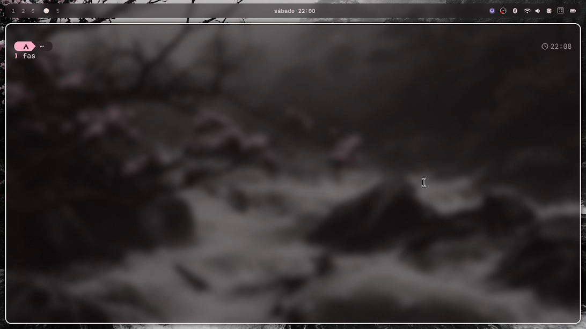
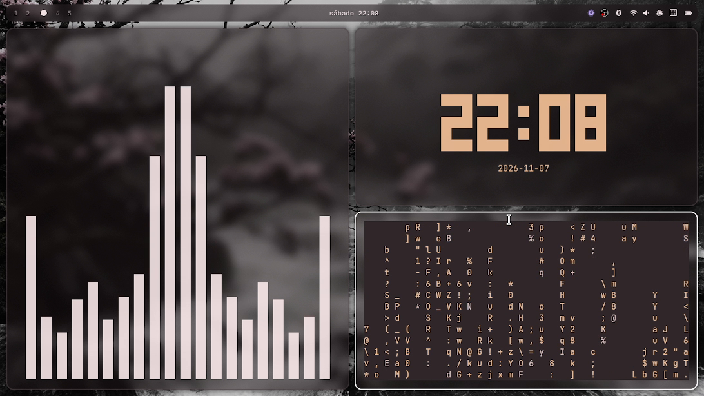
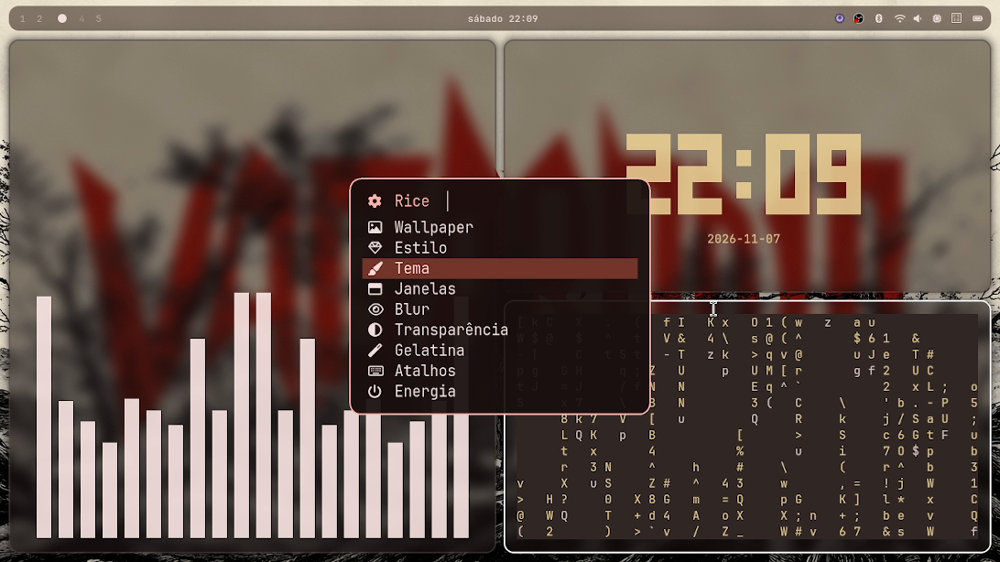
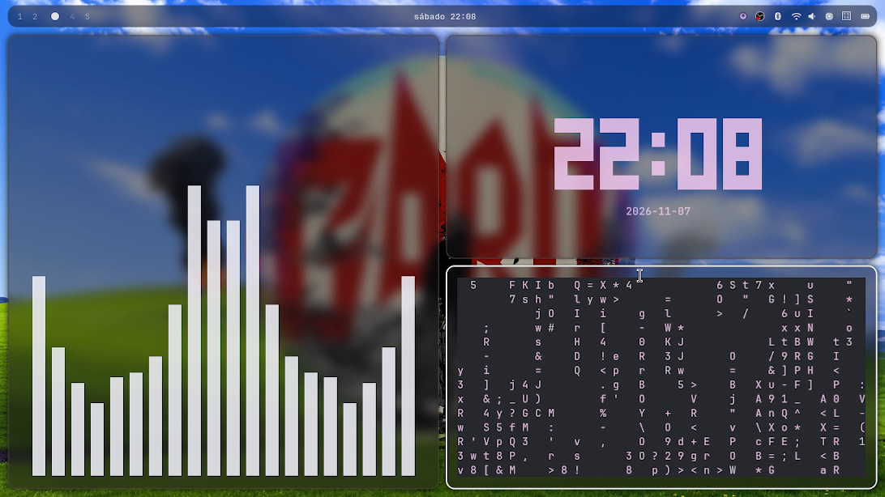

# 󰣇 my dotfiles — Hyprland Rice

<p align="center">
  
  <br>
  <b>Um ambiente desktop Linux com identidade visual própria, funcionalidade e personalização.</b>
</p>

<p align="center">
  
  
  
  
</p>

---

## 📖 Sobre

Este repositório contém a configuração pessoal de um ambiente desktop Linux focado em **aestética, funcionalidade e personalização**, construído em volta do **Hyprland**.

O objetivo é criar uma área de trabalho com identidade visual distinta, mas que mantenha uma rotina prática e confortável — com temas dinâmicos, wallpapers com cores em harmonia e um menu interativo de personalização.

---

## 📸 Prévia

<p align="center">
  
  
  
  
</p>
<p align="center"><i>Vista rápida do desktop: informações, seleção de wallpaper, widgets e integração com Spotify.</i></p>

<p align="center">
  
  
  
  
</p>
<p align="center"><i>Menu de controle e variações visuais do rice.</i></p>

---

## 🚀 Recursos

- **Hyprland** — compositor Wayland dinâmico (tiling)
- **Matugen** — gera esquemas de cores a partir do wallpaper
- **Waybar** — barra de status personalizada
- **Kitty** — terminal
- **Fuzzel** — launcher de aplicativos
- **Mako** — daemon de notificações
- **Hyprlock** — tela de bloqueio
- **Wallpaper customization** — mudança de wallpaper com cores em tempo real
- **Custom scripts** — ferramentas para personalização do desktop
- **Estilos** — troca visual entre *Padrão*, *Liquid Glass* e *Omarchy*

## ⚙️ Stack

| Componente | Propósito |
|---|---|
| Hyprland | Wayland compositor |
| Matugen | Tema dinâmico (cores) |
| Waybar | Barra de status |
| Kitty | Terminal |
| Fuzzel | Launcher |
| Mako | Notificações |
| Hyprlock | Tela de bloqueio |
| GNU Stow | Gerenciamento de dotfiles |

---

## 🛠️ Instalação

```bash
git clone https://github.com/kleberzin245-GIT/dotfiles.git ~/dotfiles
cd ~/dotfiles
./bootstrap.sh
```

Pronto. Reinicie a sessão e o ambiente é montado automaticamente.

📖 Detalhes e alternativas para outras distribuições em: [`docs/installation.md`](docs/installation.md) e [`docs/troubleshooting.md`](docs/troubleshooting.md).

> ⚠️ Revise `bootstrap.sh` antes de rodar em uma máquina nova.

---

## 📁 Estrutura

```
dotfiles/
├── bootstrap.sh          // instalação (Arch + derivados)
├── install.sh            // entrada simples
├── dotsave               // commit + push
├── rice/.config          // configs vinculadas ao $HOME via stow
├── preview/              // capturas do desktop
├── docs/                 // documentação
└── LICENSE
```

---

## 🤝 Contribuindo

Sinta-se livre para abrir *issues* ou *pull requests*.

- **Melhorias visuais** → abra um *issue* explicando o cenário atual
- **Correção de bugs** → *pull request* com a mudança + teste local
- **Novos scripts** → mantenha tudo dentro de `rice/.config/`, com documentação nos próprios scripts

---

## ⚖️ Licença

Distribuído sobre os termos da [MIT License](LICENSE).

## 👤 Créditos

Feito e mantido por **kleberzin245-GIT**.

Made with Linux, Hyprland e uma quantidade razoável de personalização.
