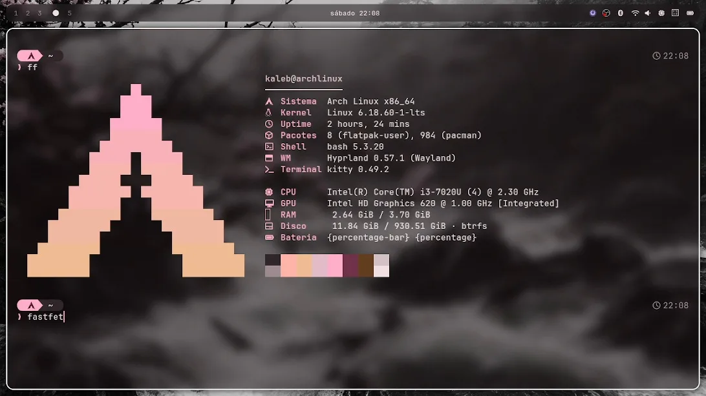
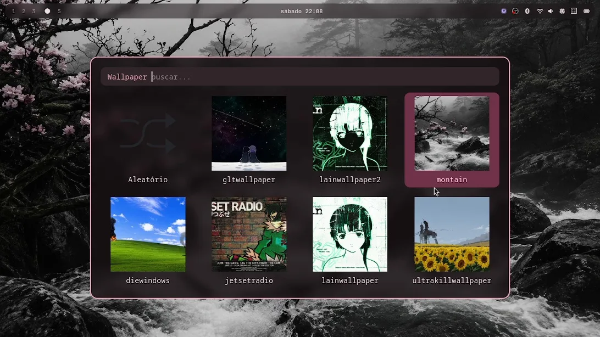
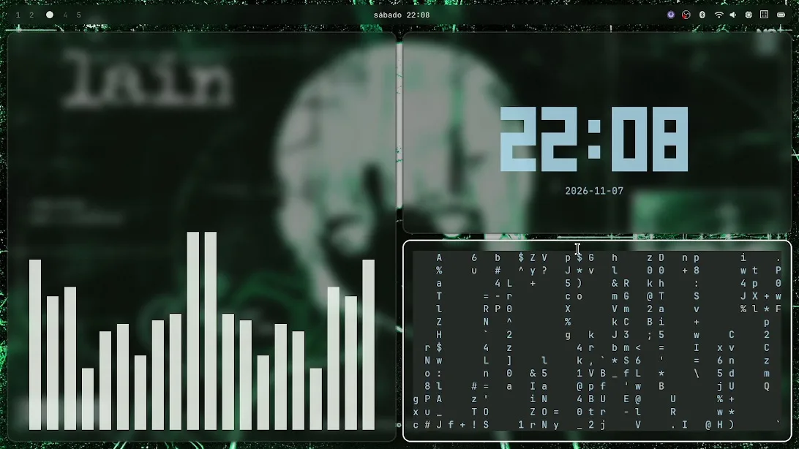
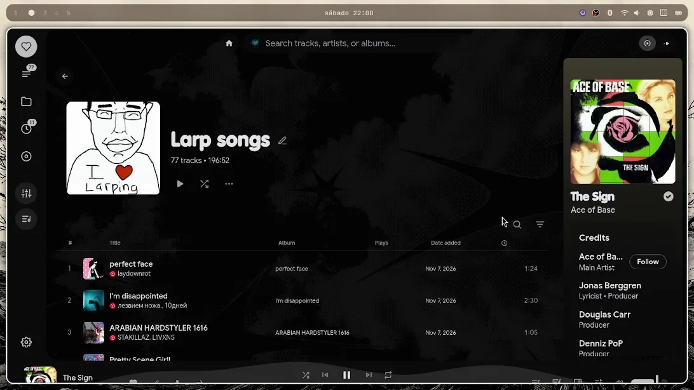
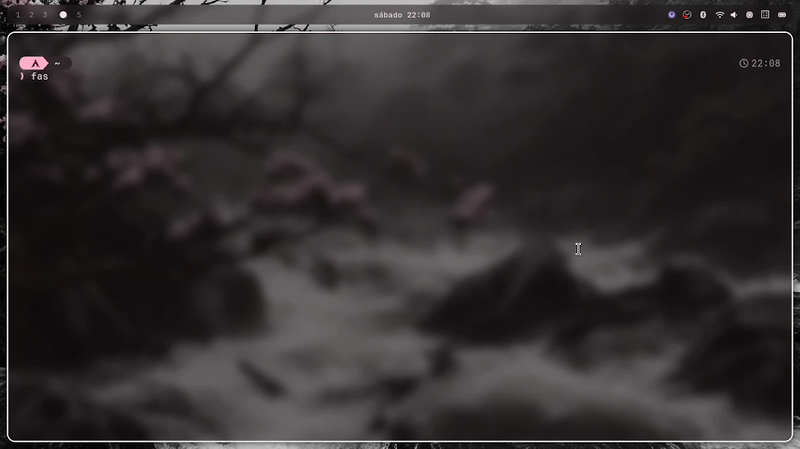
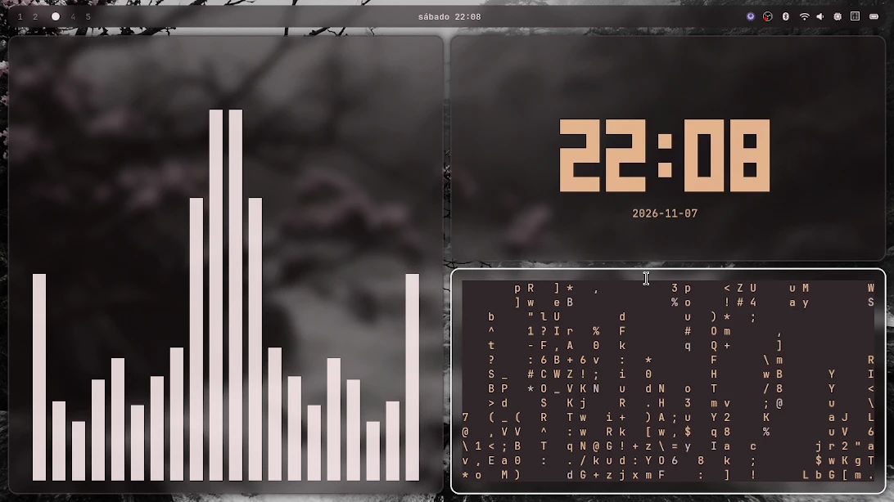
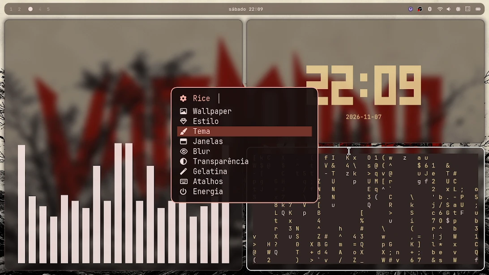

# 󰣇 my dotfiles — Hyprland Rice

<p align="center">
  
  <br>
  <b>Um ambiente desktop Linux com identidade visual própria, funcionalidade e personalização.</b>
</p>

<p align="center">
  <a href="https://github.com/kleberzin245-GIT/dotfiles/actions/workflows/lint.yml"></a>
  
  
  
  
</p>

---

## 📚 Sumário

- [Sobre](#-sobre) · [Prévia](#-prévia) · [Recursos](#-recursos) · [Stack](#️-stack)
- [Requisitos](#-requisitos) · [Instalação](#️-instalação) · [Atualizar / desinstalar](#-atualizar--desinstalar)
- [Estrutura](#-estrutura) · [Contribuindo](#-contribuindo) · [Licença](#️-licença)
- [English summary](#-english-summary)

---

## 📖 Sobre

Este repositório contém a configuração pessoal de um ambiente desktop Linux focado em **estética, funcionalidade e personalização**, construído em volta do **Hyprland**.

O objetivo é criar uma área de trabalho com identidade visual distinta, mas que mantenha uma rotina prática e confortável — com temas dinâmicos, wallpapers com cores em harmonia e um menu interativo de personalização.

---

## 📸 Prévia

<p align="center">
  
  
  
  
</p>
<p align="center"><i>Vista rápida do desktop: informações, seleção de wallpaper e menu.</i></p>

<p align="center">
  
  
  
  
</p>
<p align="center"><i>Menu de controle e variações visuais do rice.</i></p>

---

## 🚀 Recursos

- **Hyprland** — compositor Wayland dinâmico (tiling)
- **Matugen** — gera esquemas de cores a partir do wallpaper
- **Waybar** — barra de status personalizada (padrão)
- **Quickshell** — barra e Central de Controle opcionais (`RICE_SHELL=quickshell`)
- **Kitty** — terminal
- **Fuzzel** — launcher de aplicativos
- **Mako** — daemon de notificações
- **Hyprlock** — tela de bloqueio
- **Wallpaper customization** — mudança de wallpaper com cores em tempo real
- **Custom scripts** — ferramentas para personalização do desktop
- **Estilos** — troca visual entre *Padrão*, *Liquid Glass* e *Omarchy*
- **Rofi** — grade de miniaturas para escolher o wallpaper (`SUPER+SHIFT+W`)
- **Menu de controle** (`SUPER+M`) — wallpaper, estilo, tema, janelas, blur, transparência, gelatina, atalhos editáveis e energia
- **Estilos em manifestos** — um JSON por estilo em `rice/.config/rice/styles/`, renderizado por `style-render.py` para Waybar, Kitty, Fuzzel, Hyprlock, Mako, Rofi e Quickshell
- **Starship, fastfetch, eza e bat** — terminal com as cores do wallpaper

## ⚙️ Stack

| Componente | Propósito |
|---|---|
| Hyprland | Wayland compositor |
| Matugen | Tema dinâmico (cores) |
| Waybar | Barra de status (padrão) |
| Quickshell | Barra/Central de Controle (opcional) |
| Kitty | Terminal |
| Fuzzel | Launcher |
| Mako | Notificações |
| Hyprlock | Tela de bloqueio |
| Rofi       | Seletor de wallpaper      |
| Starship   | Prompt do terminal        |
| fastfetch  | Informações do sistema    |
| awww       | Wallpaper com transições  |
| GNU Stow | Gerenciamento de dotfiles |

---

## 📋 Requisitos

- **Arch Linux ou derivado** (CachyOS, EndeavourOS…), com `pacman` e `sudo`
- **Hyprland 0.55 ou mais novo** — a configuração é em Lua (`hyprland.lua`)
- Usuário normal (o `bootstrap.sh` não roda como root)
- Uma Nerd Font (o `bootstrap.sh` instala a JetBrainsMono Nerd Font)

## 🛠️ Instalação

```bash
git clone https://github.com/kleberzin245-GIT/dotfiles.git ~/dotfiles
cd ~/dotfiles
./bootstrap.sh
```

Depois, coloque algumas imagens em `~/Pictures/Wallpapers`, gere o tema uma vez com
`~/.config/hypr/scripts/wallpaper.sh ~/Pictures/Wallpapers/SUA_IMAGEM.png` e faça logout e login.

> A barra opcional em Quickshell não é instalada pelo `bootstrap.sh`. Se quiser usá-la,
> instale `quickshell` e defina `RICE_SHELL="quickshell"` em
> `~/.config/hypr/settings.local.env` (a Waybar continua sendo o padrão).

Opções do instalador:

```bash
./bootstrap.sh --dry-run        # mostra o que seria feito
./bootstrap.sh --minimal        # sem bluetooth, btop e nwg-look
./bootstrap.sh --no-bluetooth   # não mexe com bluetooth
./bootstrap.sh --no-aur         # já tenho matugen/awww instalados
```

📖 Detalhes (apenas Arch e derivados) em: [`docs/installation.md`](docs/installation.md) e [`docs/troubleshooting.md`](docs/troubleshooting.md).

## 🔄 Atualizar / desinstalar

```bash
cd ~/dotfiles
./update.sh             # git pull + stow --restow + menu.sh --init + doctor.sh
./update.sh --dry-run   # só mostra os comandos
./uninstall.sh          # remove os links do stow (mantém seus arquivos)
./uninstall.sh --remove-state   # remove também ~/.local/state/rice
```

🩺 Algo não funcionou? Rode `./doctor.sh` para um diagnóstico (ou `./doctor.sh --report` para colar numa *issue*).

> ⚠️ Revise `bootstrap.sh` antes de rodar em uma máquina nova.

---

## 📁 Estrutura

```
dotfiles/
├── bootstrap.sh          # instalação (Arch + derivados)
├── install.sh            # entrada: Arch (bootstrap) / guia nas demais
├── update.sh             # atualiza o repo e reaplica as configs
├── uninstall.sh          # remove os links do stow
├── dotsave               # commit + push
├── doctor.sh             # diagnóstico do rice (somente leitura)
├── Makefile              # atalhos: install, update, doctor, lint, test
├── CHANGELOG.md          # histórico de mudanças
├── extras/               # ajustes opcionais do sistema (zram)
├── hooks/                # git hooks do repositório
├── .github/              # CI, issue/PR templates e Dependabot
├── rice/.config          # configs vinculadas ao $HOME via stow
│   ├── rice/styles       # manifestos de estilo (JSON)
│   ├── rice/scripts      # style-render.py (gera os arquivos de estilo)
│   └── quickshell        # barra / Central de Controle opcionais
├── preview/              # capturas do desktop
├── docs/                 # documentação
└── LICENSE
```

---

## 🤝 Contribuindo

Sinta-se livre para abrir *issues* ou *pull requests*.

- **Melhorias visuais** → abra um *issue* explicando o cenário atual
- **Correção de bugs** → *pull request* com a mudança + teste local
- **Novos scripts** → mantenha tudo dentro de `rice/.config/`, com documentação nos próprios scripts
- Antes de abrir o PR rode `make lint` e `make test`; veja [`docs/CONTRIBUTING.md`](docs/CONTRIBUTING.md)

---

## 🇧🇷🇺🇸 English summary

A Hyprland rice for **Arch Linux and derivatives** with wallpaper-driven colors
(Matugen), three visual styles (Padrão, Liquid Glass, Omarchy), an interactive
control menu (`SUPER+M`), a Rofi wallpaper picker, and an optional Quickshell bar.

**Requirements:** Arch-based distro, Hyprland **0.55+** (Lua config), a Nerd Font.

```bash
git clone https://github.com/kleberzin245-GIT/dotfiles.git ~/dotfiles
cd ~/dotfiles
./bootstrap.sh
```

Then put wallpapers in `~/Pictures/Wallpapers` and run
`~/.config/hypr/scripts/wallpaper.sh ~/Pictures/Wallpapers/YOUR_IMAGE.png`.
Update with `./update.sh`; see [`docs/installation.md`](docs/installation.md)
and [`docs/troubleshooting.md`](docs/troubleshooting.md) for details.

---

## ⚖️ Licença

Distribuído sobre os termos da [MIT License](LICENSE).

## 👤 Créditos

Feito e mantido por **kleberzin245-GIT**.

Made with Linux, Hyprland e uma quantidade razoável de personalização.
